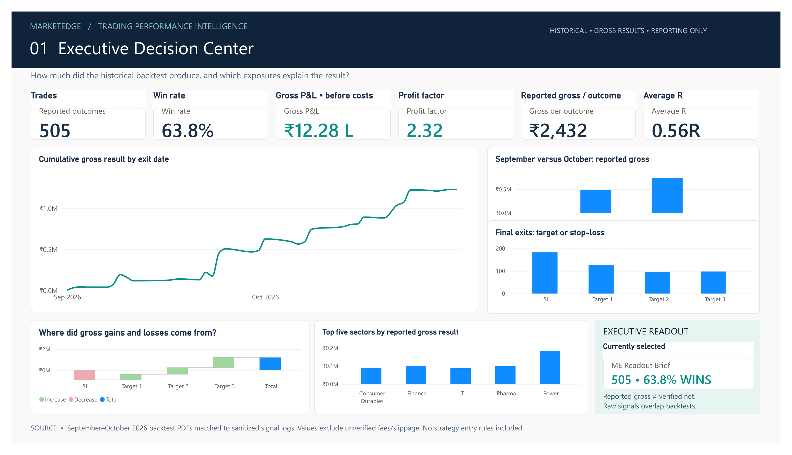
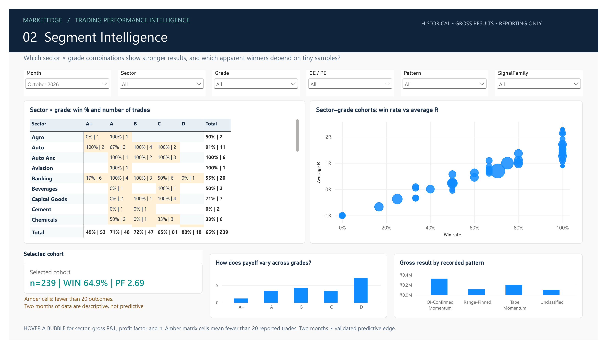
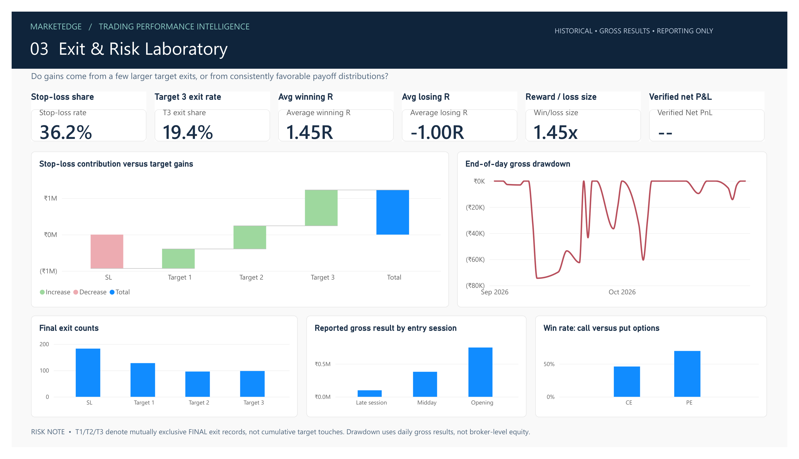
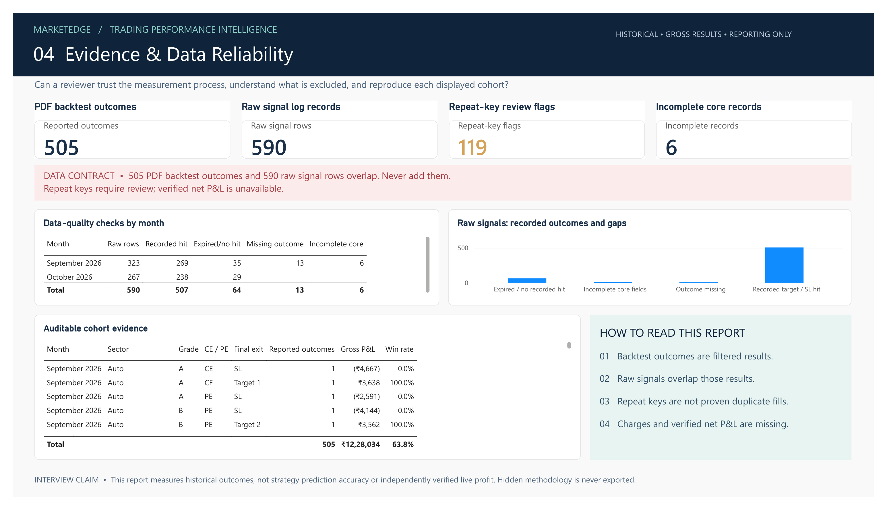

# MarketEdge — Power BI Trading Performance Intelligence

**Portfolio case study | September–October 2026**

Four interactive Power BI pages: Executive Decision Center, Segment Intelligence, Exit & Risk Laboratory, Evidence & Data Reliability.

## Business question
Which historical signal cohorts contributed gross outcomes, how do win rate and payoff differ across sectors/grades, and what data-quality gaps limit the conclusions?

## Data and methods
- 505 filtered, PDF-derived historical backtest outcomes (266 September, 239 October).
- 590 September–October raw signal-log records (323 + 267). **Do not add the two counts**; they describe overlapping observations.
- Model tables: `FactBacktest` and `FactSignals`.
- DAX: context-sensitive KPIs, gross P&L, win rate, profit factor, average R, and data-quality flags.
- Native Power BI report: four pages, slicers, waterfall, matrix, bubble chart, daily gross drawdown and audit explorer.

## File map
- `PowerBI_Project/MarketEdge_Interview_Portfolio_Ready/MarketEdge_Interview_Portfolio_Ready.pbip` — open this project in Power BI Desktop.
- `Sanitized_Data/MarketEdge_PowerBI_Premium_Sanitized_Data.xlsx` — reporting dataset supporting the visuals.
- `Sanitized_Data/MarketEdge_Sep_Oct_POWERBI_SAFE_Signals.xlsx` — sanitized raw-signal reporting view.
- `Source_And_Methodology/00_SOURCE_INDEX.xlsx` — source-to-output lineage and audit scope.
- `Source_And_Methodology/DATA_LINEAGE_AND_LIMITATIONS.md` — exact source lineage and caveats.

## Data limitations
Historical reports are not independently verified live executions. Gross P&L is **not** net profitability. Trade charges and slippage are not verified. Some source rows have missing outcomes or duplicate-key review flags. Two months of data are descriptive, not predictive.

## Privacy
Only sanitized reporting data is included in this Git-ready folder. No proprietary signal-entry thresholds or algorithm source code. The original XLSX/PDF records are kept separately in a private folder outside this Git-ready deliverable.

## Interview talking point
> I reconciled two distinct types of historical records, separated reporting outcomes from signal logs, designed interactive cohort analysis in Power BI, and made data-quality limitations visible rather than overstating gross backtest results.

## Dashboard screenshots

### 1. Executive Decision Center

### 2. Segment Intelligence

### 3. Exit and Risk Laboratory

### 4. Evidence and Data Reliability

## Open in Power BI Desktop

Open:
`PowerBI_Project/MarketEdge_Interview_Portfolio_Ready/MarketEdge_Interview_Portfolio_Ready.pbip`

This project analyzes historical, PDF-derived backtest outcomes and
overlapping signal-log records. Reported P&L is gross, not independently
verified live or net trading profitability.
